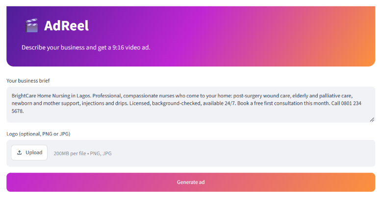
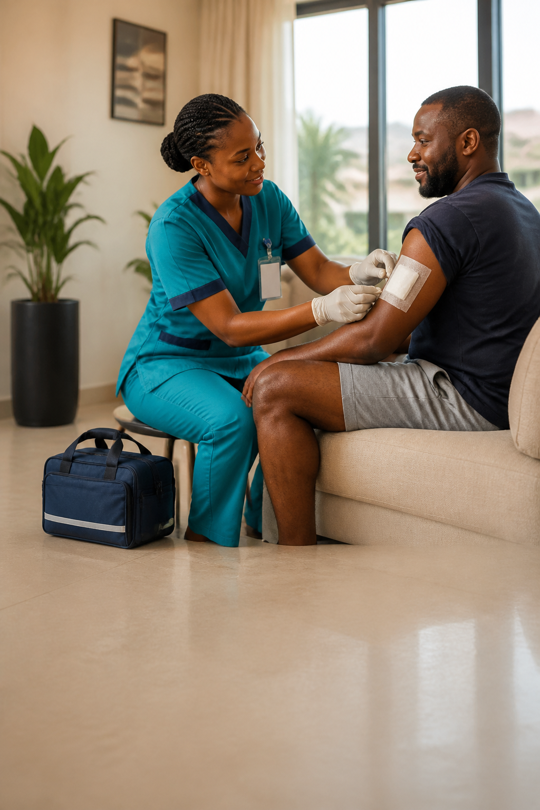
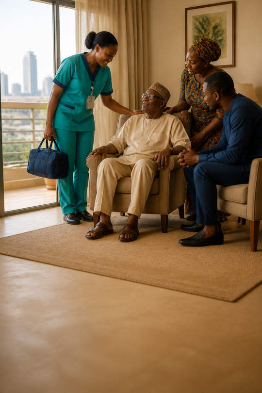
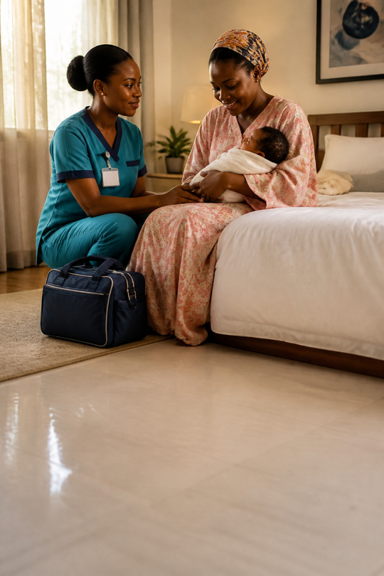
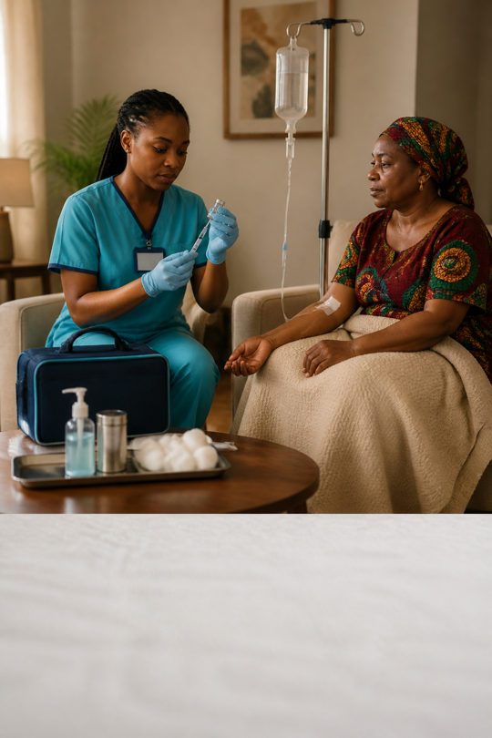
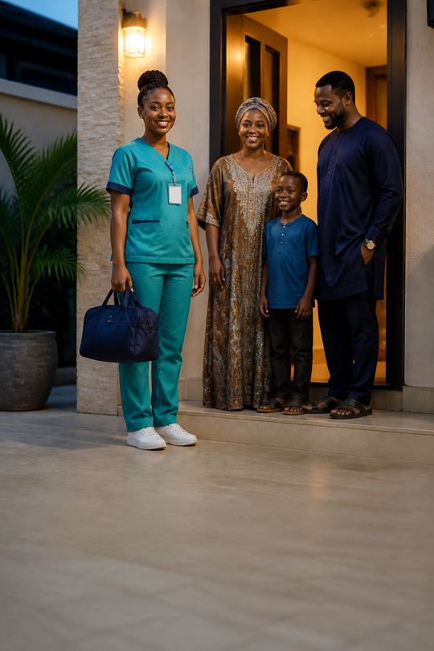
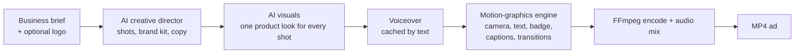

# 🎬 AdReel

Describe a small business in a few lines and get back a vertical 9:16 video ad, with camera moves, animated text, an offer badge, word-by-word captions, voiceover, your logo and a branded end card.

It runs on Python, Pillow, FFmpeg and the OpenAI API. No GPU, no Node.js, no video editor.



## Demo


https://github.com/user-attachments/assets/dac707ec-39d7-42c8-b791-0856ed688f6b


*An ad for a fictional home nursing service in Lagos*

The visuals for that ad, one image per shot:

<table>
  <tr>
    <td></td>
    <td></td>
    <td></td>
    <td></td>
    <td></td>
  </tr>
</table>

Every shot keeps the same nurse, scrubs and navy bag. That consistency is deliberate, and it's what makes the five images feel like one ad.

## Using it

Write a short brief about the business. A good one covers:

- the business name and where it is
- what it offers
- why people should trust it
- the offer or call to action
- how to get in touch

The example in the app:

> BrightCare Home Nursing in Lagos. Professional, compassionate nurses who come to your home: post-surgery wound care, elderly and palliative care, newborn and mother support, injections and drips. Licensed, background-checked, available 24/7. Book a free first consultation this month. Call 0801 234 5678.

Optionally upload a logo (PNG or JPG). Press **Generate ad**, watch the progress bar move through planning, visuals, voiceover and rendering, then download the MP4.

Briefs are limited to 1,500 characters.

## How it works



1. **Plan.** A language model acts as the creative director. From your brief it produces a set of shots, a brand kit and the copy, and the result is validated before anything else runs.
2. **Visuals.** One image per shot, generated in parallel and prompted to share the same look, so characters and props stay consistent from shot to shot.
3. **Voiceover.** Each line is recorded once and cached by a hash of its text.
4. **Render.** A motion-graphics engine written in Python draws every frame with Pillow. It adds animated camera moves, text, the offer badge, word-by-word captions and your logo, then crossfades the shots and finishes on a branded end card.
5. **Encode.** Frames are piped straight to FFmpeg, which encodes the video and mixes in the voiceover.

## Setup

**You need**

- Python 3.10 or newer
- [FFmpeg](https://ffmpeg.org/download.html), with `ffmpeg` and `ffprobe` on your PATH
- An OpenAI API key

**Install**

```bash
git clone https://github.com/Jaycobson/adreel.git
cd adreel

python -m venv .venv
.venv\Scripts\activate          # macOS/Linux: source .venv/bin/activate
pip install -r requirements.txt

copy .env.example .env          # macOS/Linux: cp .env.example .env
```

Put your key in `.env`:

```
OPENAI_API_KEY=your-key-here
```


Then open `http://localhost:8501`.

**Tests and linting**

```bash
pytest
ruff check .
```

**Background music (optional).** Drop a file named `music.mp3` into `assets/`. It plays under the voiceover and gets quieter whenever the voice is speaking.

## Design notes

- **Two stages.** Image generation is the slow, costly part, so it happens once. Wording and camera moves are applied in the render stage, which means they can be changed and re-rendered without paying for new images. The current Streamlit page runs both stages back to back.
- **Voice cache.** Clips are stored by text hash. If you change one line, only that line is re-recorded.
- **Timing.** Caption timing is weighted by word length, so longer words stay on screen a bit longer than short ones.
- **Crossfades.** Shots overlap slightly so each transition blends rather than cuts.
- **Reliability.** Director output is validated, API calls retry with backoff, and the tests run end to end with fake API calls, so they need no key.

## Project layout

```
.
├── app.py                 # Streamlit interface
├── studio/
│   ├── director.py        # planning: shots, brand kit, copy
│   ├── media.py           # images, voiceover, audio
│   ├── engine.py          # frame renderer
│   └── pipeline.py        # runs the stages in order
├── assets/                # optional music.mp3
├── tests/                 # pytest suite with fake API calls
└── requirements.txt
```

Generated ads are written to `outputs/`, one timestamped folder per run.


